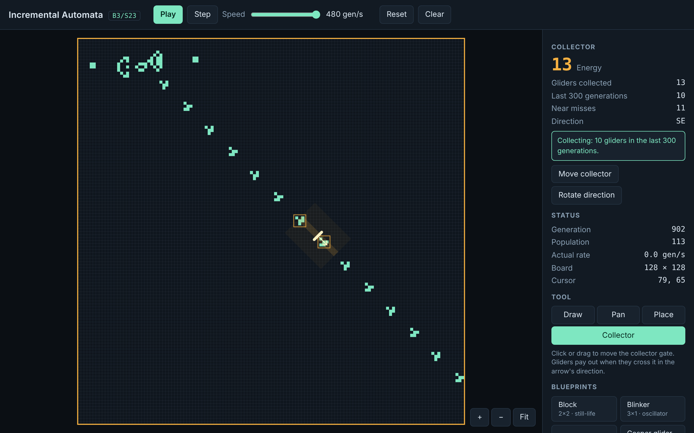

# Incremental Automata

A browser-first incremental automation game where real Conway's Game of Life
(B3/S23) patterns are the machines. A separate game layer supplies collectors,
energy, research and progression. Every claimed machine actually works under
the automaton's rules.

**Status:** Phase 2 (first genuine factory) complete: a Gosper gun, a movable directional collector that pays one
energy per real glider crossing, and diagnostics that explain misses. See
[`docs/PHASE2_REPORT.md`](docs/PHASE2_REPORT.md) and [`docs/PHASE1_REPORT.md`](docs/PHASE1_REPORT.md).



## Run

```bash
npm install
npm run dev            # http://localhost:5173
npm test               # unit + reference fixtures
npm run test:e2e       # Playwright (Chromium)
npm run bench          # add -- --browser for render timing
```

Controls: Space play/pause · N step · C collector tool · R rotate · M mirror · F fit · Esc draw tool · wheel zoom · right-drag pan.

## Docs

- Plan and phase gates: [`docs/MASTER_PLAN.md`](docs/MASTER_PLAN.md)
- Architecture: [`docs/ARCHITECTURE.md`](docs/ARCHITECTURE.md) · Tests: [`docs/TEST_PLAN.md`](docs/TEST_PLAN.md) · Provenance: [`docs/LICENSE_PROVENANCE.md`](docs/LICENSE_PROVENANCE.md)
- Agent tooling (skills, MCP): [`docs/DEV_TOOLING.md`](docs/DEV_TOOLING.md) · Agent rules: [`CLAUDE.md`](CLAUDE.md)
