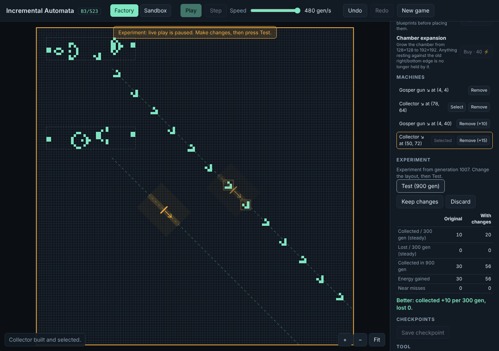

# Incremental Automata

A browser-first incremental automation game where real Conway's Game of Life
(B3/S23) patterns are the machines. A separate game layer supplies collectors,
energy, research and progression. Every claimed machine actually works under
the automaton's rules.

**Status:** Phase 4 (experimentation) complete. Earn energy from real glider passages, build guns and collectors,
and work through 7 goals. Then experiment safely: branch the game, change the layout, **Test** it against the
original over the same generations, and keep or discard. Undo/redo, checkpoints, collector snapping and stream-collision
warnings included. See [`docs/PHASE4_REPORT.md`](docs/PHASE4_REPORT.md) (and phases
[1](docs/PHASE1_REPORT.md), [2](docs/PHASE2_REPORT.md), [3](docs/PHASE3_REPORT.md)).



## Run

```bash
npm install
npm run dev            # http://localhost:5173
npm test               # unit + reference fixtures
npm run test:e2e       # Playwright (Chromium)
npm run bench          # add -- --browser for render timing
```

Controls: Space play/pause · N step · Ctrl+Z / Ctrl+Shift+Z undo/redo · C move collector (Shift: no snapping) · R rotate (gun with Orientation tools / new collector's direction) · M mirror · F fit · Esc select tool · wheel zoom · drag empty space or right-drag to pan.

## Docs

- Plan and phase gates: [`docs/MASTER_PLAN.md`](docs/MASTER_PLAN.md)
- Architecture: [`docs/ARCHITECTURE.md`](docs/ARCHITECTURE.md) · Tests: [`docs/TEST_PLAN.md`](docs/TEST_PLAN.md) · Experiments: [`docs/EXPERIMENTS.md`](docs/EXPERIMENTS.md) · Provenance: [`docs/LICENSE_PROVENANCE.md`](docs/LICENSE_PROVENANCE.md)
- Agent tooling (skills, MCP): [`docs/DEV_TOOLING.md`](docs/DEV_TOOLING.md) · Agent rules: [`CLAUDE.md`](CLAUDE.md)
